# 观心 P0 体验记录（2026/10/31 18:51:30）

- 版本：v125（工作区 commit 6de636d，工作区干净）
- 视口：390×844 @2x（移动端真实形态）
- 方式：真实浏览器、真实点击、真实 localStorage，未 pin 任何序号
- 说明：本文件只记录**实际观察到的行为**，通过与否由董事长判定

## 一、三个核心流程（董事长验收标准）

## 1. 问心 —— 失败标准：重复抽取、顺序丢失

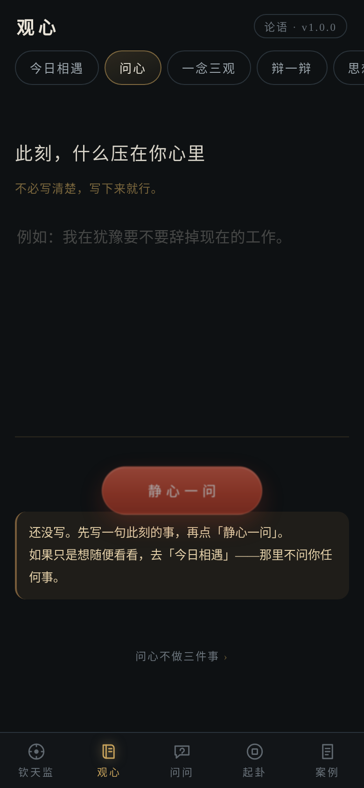

- ✅ **空问题点「静心一问」：是否给出提示**：true
- ✅ **空问题点「静心一问」：是否消耗当日序号（不应消耗）**：true　_n=null_
- ✅ **提示是否给出另一条路（今日相遇）**：true　_还没写。先写一句此刻的事，再点「静心一问」。如果只是想随便看看，去「今日相遇」——那里不问你任何事。_
- ✅ **空问题时是否仍然抽出了结果（不应抽）**：true　_未抽取_

- ✅ **问心第一次抽到**：无结果
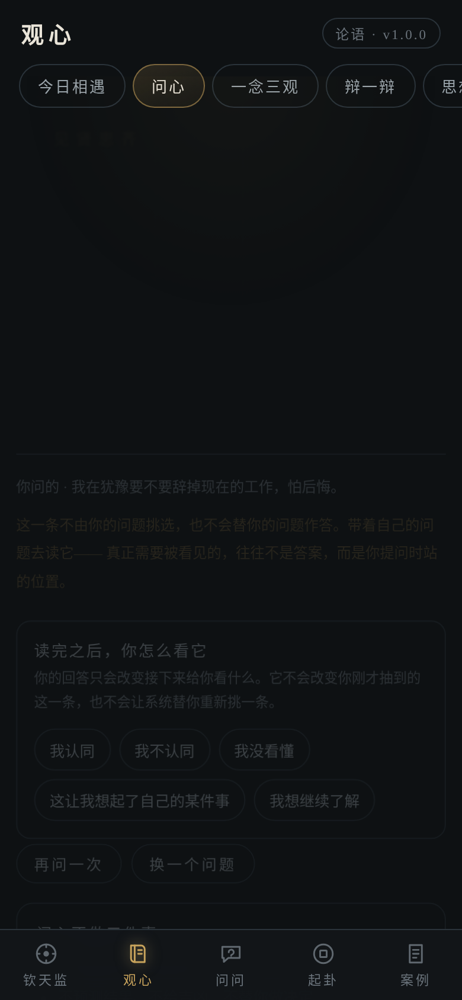

- ✅ **问心同一天第二次抽到**：无结果
- ❌ **★ 同一天连续两次不重复**：false　_null vs null_
- ✅ **抽两次后的当日序号状态**：{"d":"2026-10-31","n":1}
- ✅ **退出重进后输入框是否残留上次的问题**：已清空（每次重新问）

- ✅ **退出重进后第三次抽到**：无结果
- ✅ **重进并再问一次后的当日序号状态**：{"d":"2026-10-31","n":2}
- ✅ **★ 退出重进后顺序延续（序号递增，不是回到开头）**：true　_重进前 n=1，重进后再问 n=2_
- ✅ **★ 三次抽取互不重复**：true

## 2. 一念三观 —— 失败标准：仅仅保证三条内容不同

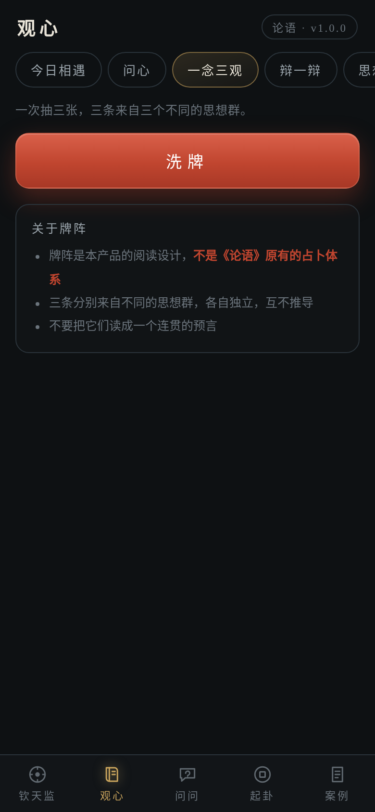

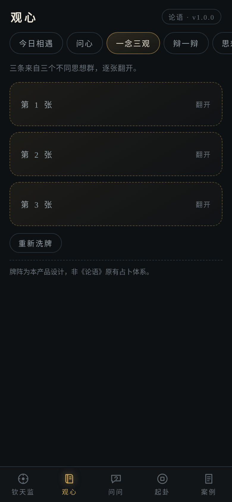

- ✅ **洗出牌背数量**：3
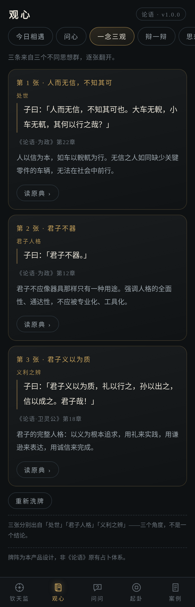

- ✅ **三张牌各自的原文首句**：子曰：「人而无信，不知其可也。大车无 ｜ 子曰：「君子不器。」 ｜ 子曰：「君子义以为质，礼以行之，孙以
- ✅ **三张牌各自所属思想群**：处世 ｜ 君子人格 ｜ 义利之辨
- ✅ **★ 三条来自三个不同思想群（分层抽样）**：true　_不同群数 3_
- ✅ **三条内容互不重复**：true

## 3. 辩一辩 —— 失败标准：提前泄露解释、出现正确答案、无法修改立场

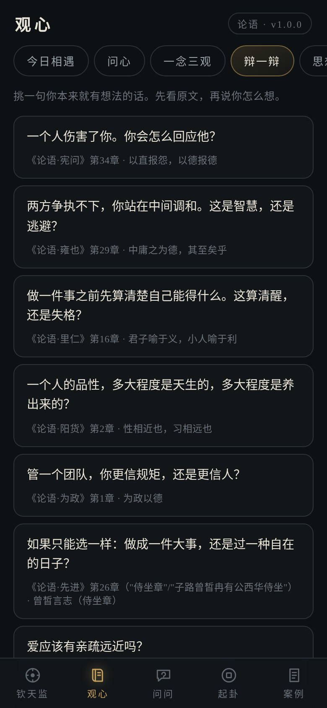

- ✅ **辩题数量**：8
- ✅ **辩题清单**：D-01 D-02 D-03 D-04 D-05 D-06 D-07 D-08
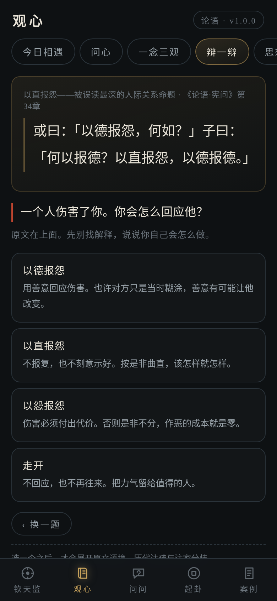

- ✅ **选立场前：是否展示原文**：true
- ✅ **选立场前：是否给出面向用户的问题**：true
- ✅ **选立场前：立场选项**：以德报怨用善意回应伤害。也许对方只是当时糊涂，善意有可能让他改变。 / 以直报怨不报复，也不刻意示好。按是非曲直，该怎样就怎样。 / 以怨报怨伤害必须付出代价。否则是非不分，作恶的成本就是零。 / 走开不回应，也不再往来。把力气留给值得的人。
- ✅ **★ 选立场前不出现历代注疏**：true
- ✅ **★ 选立场前不出现「原典实际说了什么」**：true
- ✅ **★ 选立场前不出现「这一路历史上谁走过」**：true
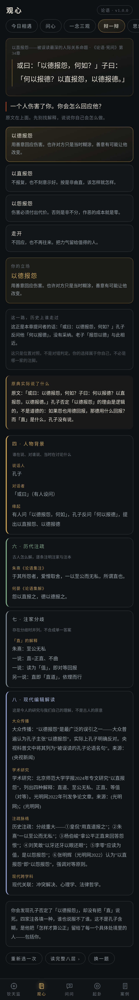

- ✅ **选立场后：展开历代注疏**：true
- ✅ **选立场后：展开注家分歧**：true
- ✅ **选立场后：给出「原典实际说了什么」**：true　_原典实际说了什么原文：「或曰：以德报怨，何如？子曰：何以报德？以直报怨，以德报德。」孔子否定「以德报怨」的理由是逻辑的，不是道德的：如果怨也用德回报，那德用什么_
- ✅ **选立场后：给出「这一路历史上谁走过」**：true
- ✅ **★ 全程不出现对错判定**：true　_扫「答对/答错/你选错/你答对/正确答案是/标准答案是」_
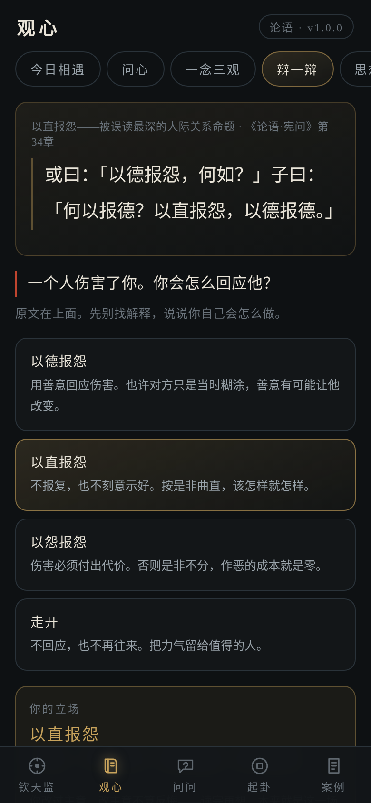

- ✅ **★ 允许改立场，且界面如实记录**：true　_当前选中：以直报怨不报复，也不刻意示好。按是非曲直，该怎样就怎样。_
- ✅ **改主意后未被评价（不出现「前后不一 / 立场不稳 / 你之前说」）**：true

## 二、辅助检查

- ✅ **五种反馈全部呈现**：true　_["agree","disagree","unsure","recall","more"]_
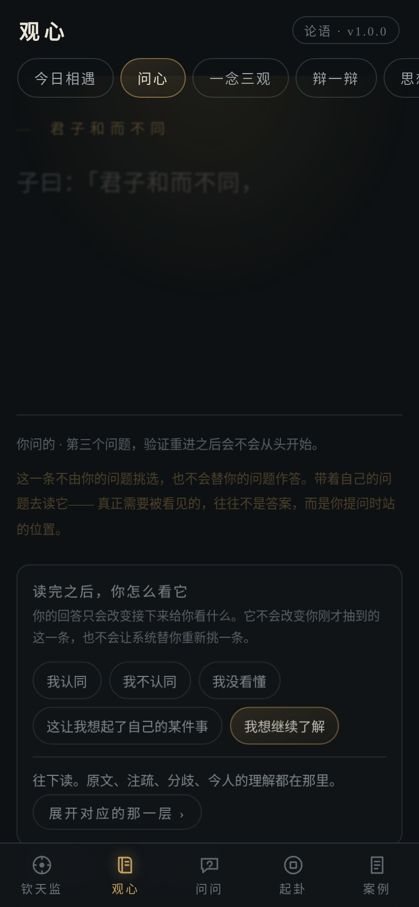

- ✅ **★ 点完全部五种反馈后当前条目保持不变**：true　_原条目 null，变化 0 次_
- ✅ **从探索面板进入 LY-013 详情页（真实入口）**：true　_ok_
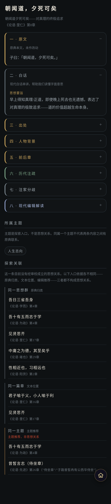

- ✅ **孤立节点的入口及其性质**：cluster｜同一思想群原典归类 ; chapter｜同一篇章文本位置 ; topic｜同一主题主题推荐
- ✅ **★ 孤立节点的主题入口有据可查（有内容给入口，无内容如实说明）**：true　_给出「同一主题」入口，并标注「主题推荐，非思想关系」_

## 三、异常状态与交互反馈

- ✅ **空字符串输入点静心一问：不抽取**：true　_panel=ok typed={"found":false} clicked=no-el warn=null result=null_
- ✅ **纯空白输入按「没写」处理（不抽取）**：true　_panel=ok typed={"found":false} clicked=no-el warn=null result=null_
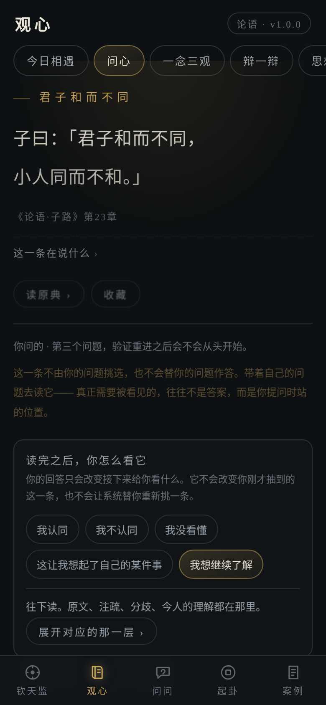

- ✅ **2000 字输入是否崩溃**：未抽出
- ✅ **2000 字输入后页面是否仍可读**：true

- ❌ **当日序号是坏 JSON 时是否仍能抽取**：false　_未抽出_
- ✅ **旧日期序号（1999-01-01 n=17）跨日后的处理**：{"d":"1999-01-01","n":17}　_未抽出_

- · **渲染不存在的内容 id（LY-999）**：正文 7 字 / 0 层　_未找到该条目。_
- ✅ **★ 不存在的内容 id 不猜身份、不白屏**：true
- · **渲染 undefined id 的处理**：正文 7 字 / 0 层　_未找到该条目。_
- ✅ **缺 display_class 的关系的展示判定**：{"ok":false,"badge":"展示分类缺失","tone":"none","wording":"这条关系缺少展示分类，无法判断性质，暂不展示"}
- ✅ **非法 display_class 的关系的展示判定**：{"ok":false,"badge":"展示分类缺失","tone":"none","wording":"这条关系缺少展示分类，无法判断性质，暂不展示"}
- ✅ **★ 两者都不会被标成「原典有据」**：true

## 四、26 个思想节点完整可达

- ✅ **内容库节点总数**：26
- ✅ **每个节点都能渲染出八层**：true　_26/26 均 8 层_
- ✅ **没有空层（某层渲染成空白）**：true　_无空层_

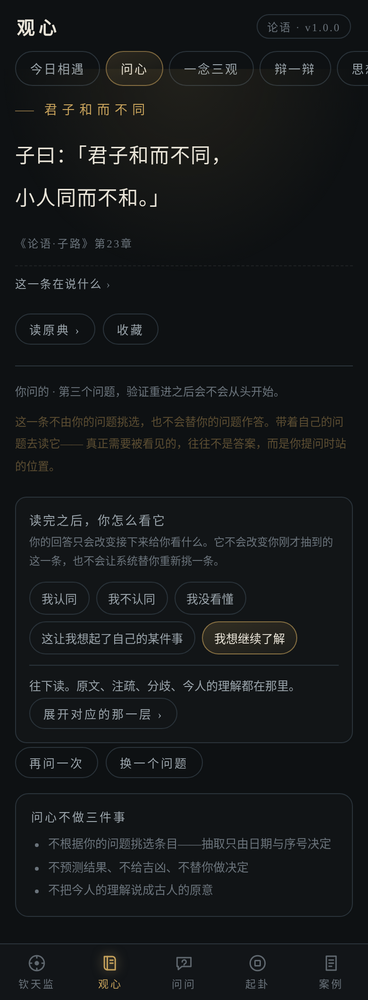

## 五、运行期异常

- ✅ **未捕获异常数**：0
- ✅ **console.error 数**：0
- ✅ **资源加载失败数**：0