# 观心 P0 体验记录（2026/11/4 02:46:21）

- 版本：v127（工作区 commit 894eb5f，**有未提交改动**）
- 视口：390×844 @2x（移动端真实形态）
- 方式：真实浏览器、真实点击、真实 localStorage，未 pin 任何序号
- 说明：本文件只记录**实际观察到的行为**，通过与否由董事长判定

## 一、打开观心：第一屏给全了吗（产品文件「第一阶段」）

- ✅ **从底部导航进入观心**：true　_ok_
- ✅ **第一屏有原文**：true　_「子曰：「君子喻于义，小人喻于利。」…」_
- ✅ **第一屏有出处**：true　_《论语·里仁》第16章_
- ✅ **第一屏有现代解释**：true　_「君子看一件事先看该不该做，小人先看有没有好处。…」_
- ✅ **第一屏有思考角度**：true　_「值得想一下
      这句常被读成「利益是坏的…」_
- ✅ **第一屏有继续探索入口**：true　_这句话背后还有什么 ›_
- ✅ **★ 原文不用滚动就在首屏**：true
- ✅ **★ 现代解释不用滚动就在首屏**：true
- ✅ **★ 继续探索入口不用滚动就在首屏**：true
- ✅ **现代解释被标注为编辑撰写、不是古人原意**：true　_现代解读 · 本产品编辑撰写，不是古人原意_
- ✅ **三个入口是「今日 / 困惑 / 手记」**：true　_今日/困惑/手记_
- ✅ **收藏仍可用（旧功能未删）**：true
- ✅ **★ 首屏不出现编辑后台词汇**：true

## 二、阅读五步：看懂 → 发现 → 探索 → 联系自己 → 留下收获

- ✅ **第 1 步可以往下展开**：true　_ok_
- ✅ **第 2 步给出「这句话是在什么场合说的」**：true　_这句话是在什么场合说的 谁说的孔子对谁说泛论（论义利）当时在谈什么以「喻」（知晓_
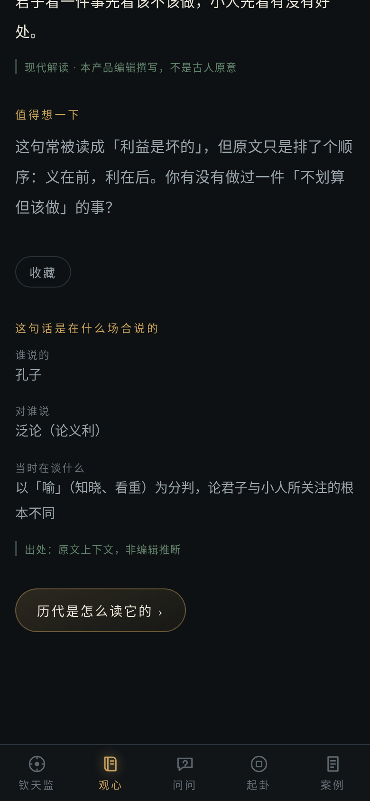

- ✅ **第 2 步可以继续往下展开**：true　_ok_
- ✅ **第 3 步有「历代注家怎么解」**：true　_历代注家怎么解 朱熹论语集注 喻，犹晓也。义者，天理之所宜；利者，人情之_
- ✅ **第 3 步有「完整资料」入口（原典八层仍可达）**：true
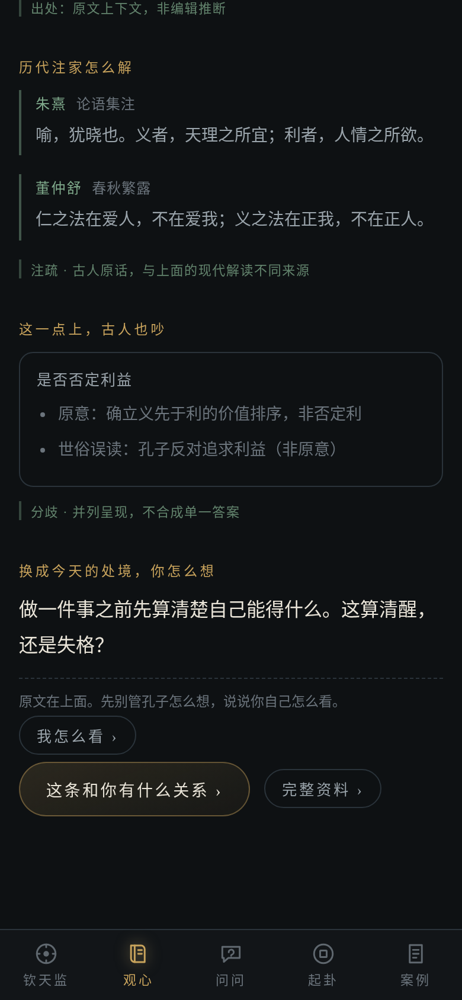

- ✅ **第 3 步有「我怎么看」入口**：true　_我怎么看 ›_
- ✅ **★ 点开后不跳页，仍在这一条内容里**：true
- ✅ **四段齐全（原文在说什么/历代注家/我有不同看法）**：true　_原文在说什么 / 历代注家怎么理解这一点 / 我有不同看法_
- ✅ **★ 列的是多种读法，不是正反两方**：true　_读法 3 种_
- ✅ **★ 不选任何读法也能写自己的理由**：true
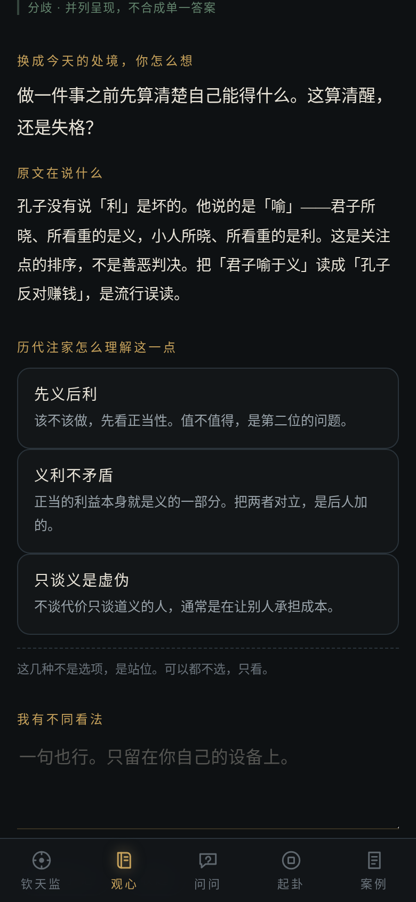

- ✅ **选了之后显示「你更接近哪一种理解」**：true　_你更接近「先义后利」_
- ✅ **★ 明确写着这不是对错判定**：true　_对照，不是对错判定。你的选择属于你自己，不必是哪一家的注脚。_
- ✅ **另一种读法被标为「如果你站在另一边」**：true　_如果你站在另一边_
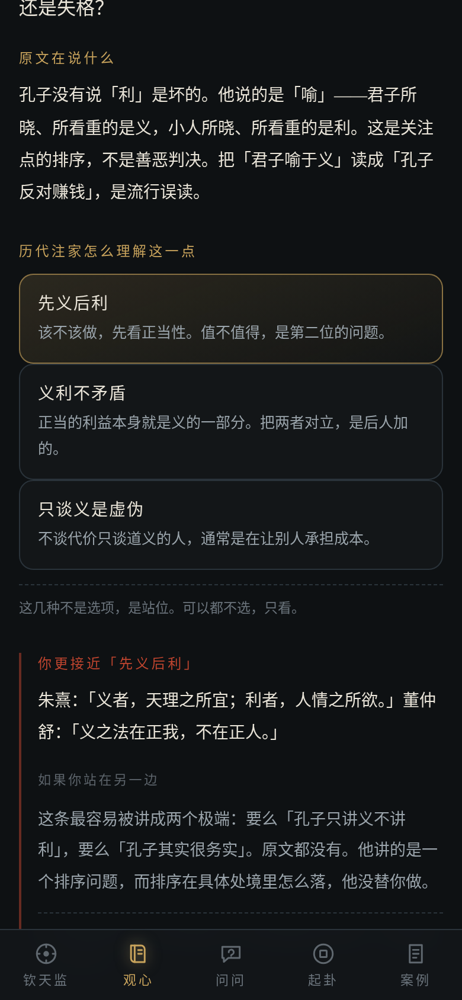

- ✅ **第 3 步可以继续往下展开**：true　_ok_
- ✅ **★ 五种反馈全部在（触动/了解/不同看法/没想明白/留下想法）**：true　_这句话触动了我 / 我有不同看法 / 我还没想明白 / 我想留下自己的想法 / 我想进一步了解_
- ✅ **★ 明确写了「可以不选」**：true
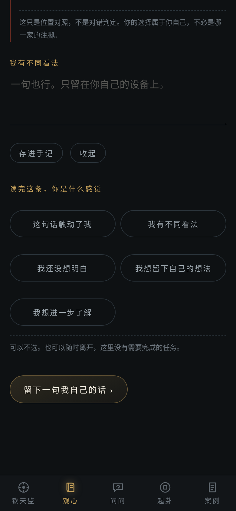

- ✅ **★ 表达「有不同看法」后立刻得到回应**：true　_不认同是正当的。历代注家在这一点上本来就分岔——你会发现，古人也未必只有一种读法_
- ✅ **回应里给了下一步（不是一句「收到」）**：true　_看看古人怎么吵的 ›_
- ✅ **★ 回应文案不含「层」这类内部术语**：true　_不认同是正当的。历代注家在这一点上本来就分岔——你会发现，古人也未必只有一种读法。 看看古人怎么吵的 ›_
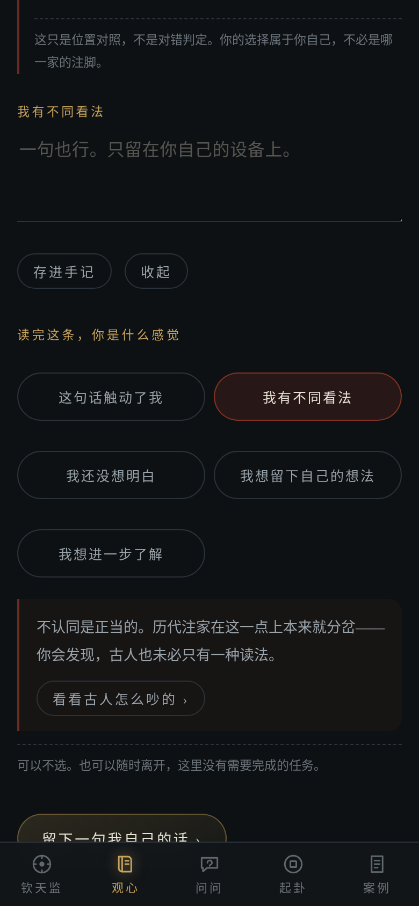

- ✅ **第 4 步可以继续往下展开**：true　_ok_
- ✅ **第 5 步有手记输入框**：true
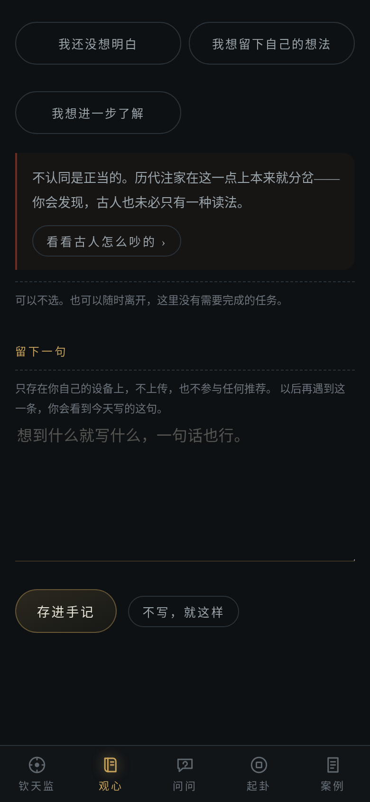

- ✅ **点「存进手记」**：true　_ok_
- ✅ **★ 存完自动进入结束态（不是停在输入框）**：true
- ✅ **★ 结束态把刚写的那句话显示出来**：true
- ✅ **★ 存完后不再留着空输入框等人写第二遍**：true
- ✅ **手记真的写进了本地存储**：true　_条数 1_
- ✅ **结束态给了下一步（不是「已完成」就没了）**：true　_今天这一条读完了 你今天留下一句：「我一直以为克己是压抑自己。原来还有另一种读法_
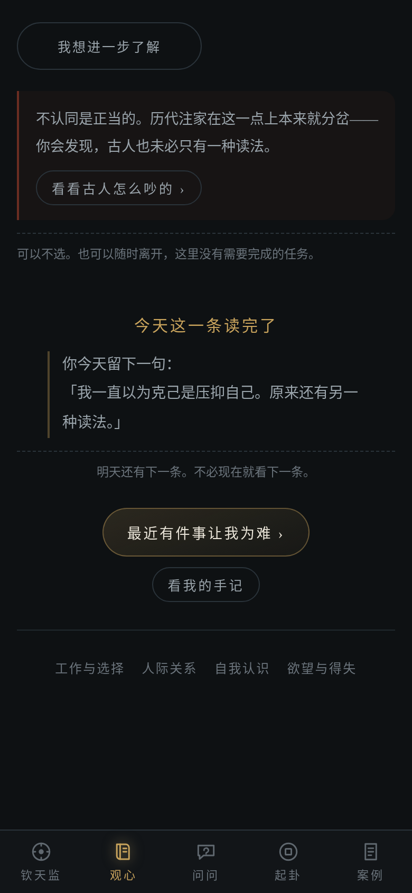

## 三、思想手记（产品文件称「最重要的长期功能」）

- ✅ **能进入手记页**：true　_ok_
- ✅ **★ 手记页能看到刚写的那条**：true　_1 条：11月3日 君子喻于义，小人喻于利 我一直以为克己是压抑自己。原来还有另一种读法_
- ✅ **手记页说明了它是什么**：true　_只放你自己写的东西，一共 1 条。不评分，也不替你总结。_
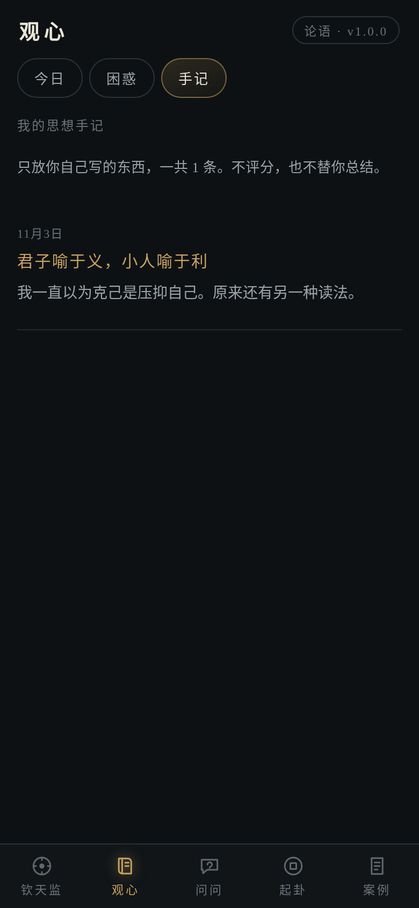

- ✅ **能回到今日**：true　_ok_
- ✅ **★ 再次遇到同一条时，提示「你曾经读过」**：true　_你曾经读过这一条 11月3日，你留下过这样的话： 我一直以为克己是压抑自己。原来_
- ✅ **★ 提示里带着上次写的话**：true　_你曾经读过这一条 11月3日，你留下过这样的话： 我一直以为克己是压抑自己。原来还有另一种读法。_
- ✅ **旧记录没有挤掉原文（原文仍在）**：true
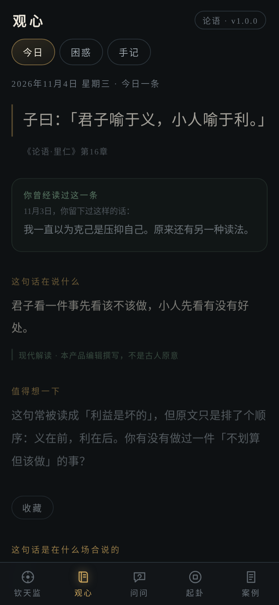

## 四、困惑探索：8 个现实问题入口，零输入可用

- ✅ **能进入困惑页**：true　_ok_
- ✅ **★ 8 个现实问题入口都在**：true　_工作与选择 要不要换、值不值、怎么选 / 人际关系 和谁处不来、怎么开口、要不要退让 / 自我认识 我是谁、我到底想要什么 / 欲望与得失 想要又怕、得到又空 / 人生方向 往哪走、还来不来得及 / 情绪与安顿 烦、闷、静不下来 / 原则与现实 该不该坚持、要不要低头 / 人生意义 这一切为了什么_
- ✅ **★ 不需要写任何东西就能用（页面没有输入框）**：true
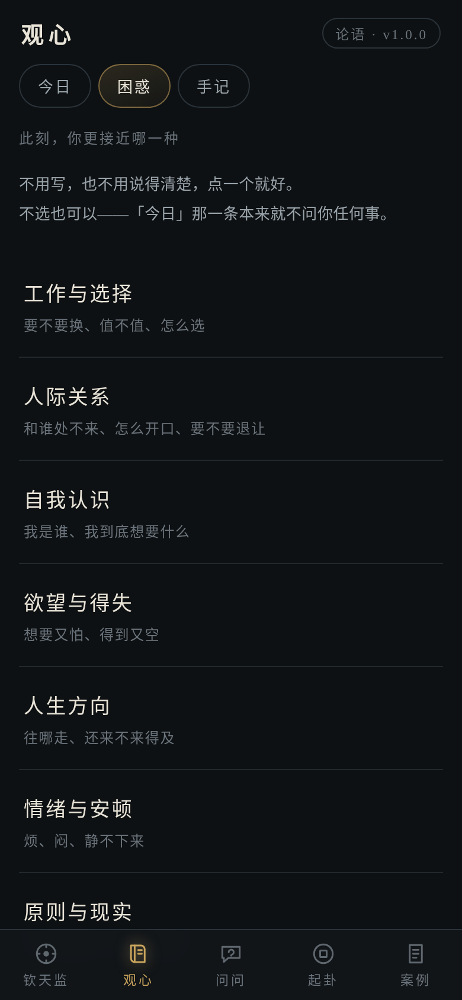

- ✅ **★ 每个主题下都有可读条目（没有空入口）**：true　_work:6 people:8 self:6 desire:6 direction:6 mood:6 principle:6 meaning:7_
- ✅ **★ 主题内容带推荐顺序**：true　_1,2,3,4,5,6,7_
- ✅ **★ 每一条都有推荐理由**：true　_7/7_
- ✅ **★ 每一条都标了关联类型与是否适合初读**：true　_7/7_
- ✅ **主题写明了阅读路径**：true　_阅读路径：先问什么值得 → 再看意义可不可以很小 → 最后看它怎么长出来_
- ✅ **主题页说明了「同主题≠原典关系」**：true
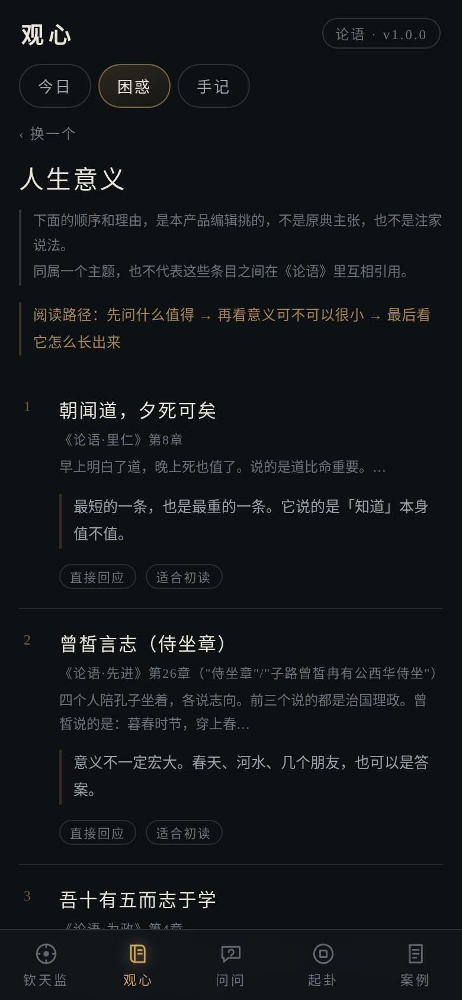

- ✅ **★ 从主题点进去能直接开始读一条**：true　_子曰：「朝闻道，夕死可矣。」_
- ✅ **从主题进入时回到第 1 步（不是接着上一条的进度）**：true
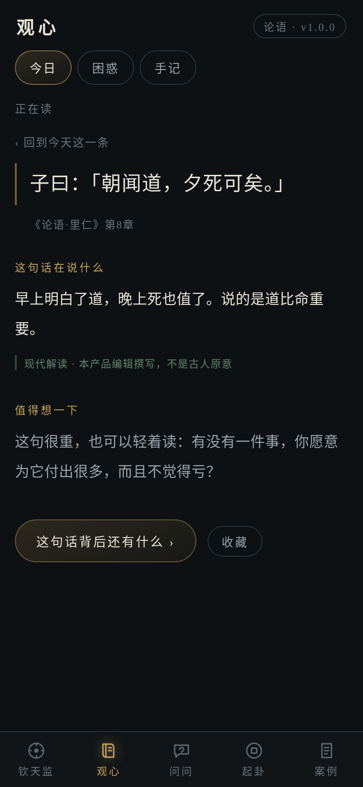

## 五、异常与边界：显式失败，不猜一个看起来合理的结果

- ✅ **（前置）能回到今日面板做空手记测试**：true　_ok_
- ✅ **空手记不会存成一条空记录**：true　_总条数 1_
- ✅ **空手记给出提示而不是静默**：true　_还没写。写一句就行，也可以点「不写，就这样」。_
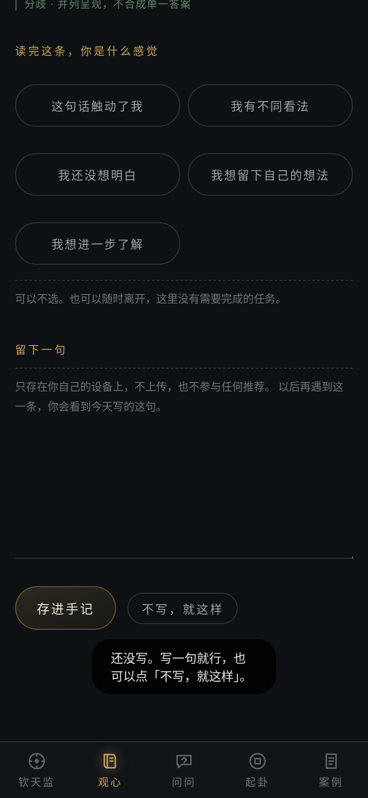

- ✅ **坏 localStorage 下页面仍能打开**：true
- ✅ **坏数据下不崩、原文照常显示**：true
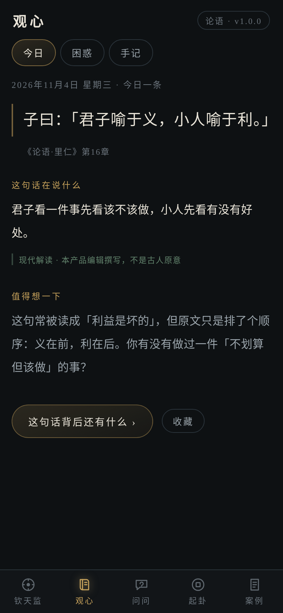

- ✅ **（前置）能回到今日面板做异常 id 测试**：true　_ok_
- ✅ **不存在的内容 id 不抛异常**：true　_dispatched_
- ❌ **不存在的内容 id 时观心页面仍可用**：false
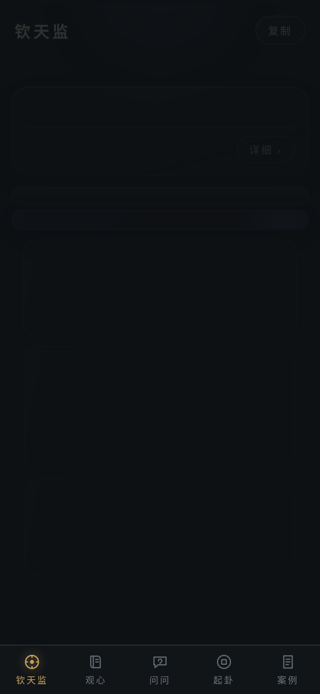

## 六、六维正反馈自查（产品文件检查表）

- ✅ **① 被理解：打开就有现代解释 + 思考角度**：true　_解读 23 字 / 思考 64 字_
- ✅ **② 发现新东西：给出场合、易读错处、历代注家**：true　_第2步 77 字 / 第3步 95 字_
- ✅ **③ 想法更清晰：能写下自己的话并回看**：true　_手记 1 条_
- ✅ **④ 表达后有回应：反馈立刻得到回应与下一步**：true　_看看古人怎么吵的 ›_
- ✅ **⑤ 带走收获：读完有结束、有下一步**：true　_今天这一条读完了 你今天留下一句：「我一直以为克己是压抑自己_
- ✅ **⑥ 回来有新理解：再次遇到时提示上次想法**：true　_你曾经读过这一条 11月3日，你留下过这样的话： 我一直以为_

## 七、运行期异常

- ✅ **未捕获异常数**：0
- ✅ **console.error 数**：0
- ✅ **资源加载失败数**：0